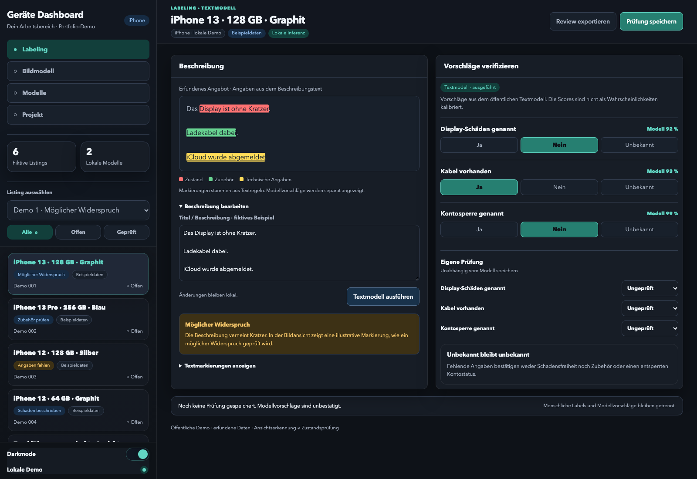
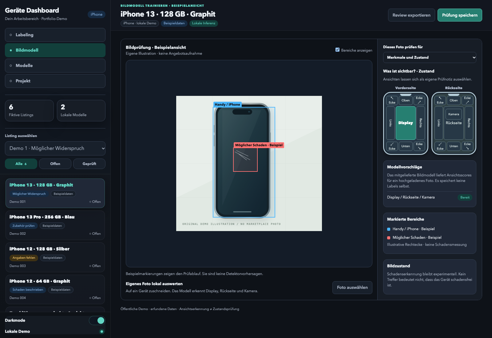
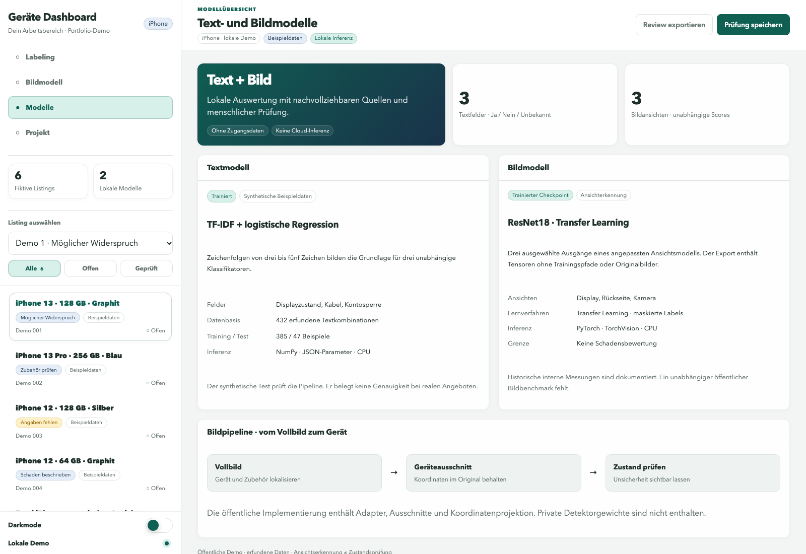

# Multimodal Device Inspection

**Local text and image analysis, with evidence-aware human review.**

An applied machine-learning portfolio project that turns device descriptions and photos into reviewable suggestions. It combines a small text classifier, a trained device-view model and an inspection interface that keeps predictions separate from confirmed facts.



*Screenshot of the running public demo using the existing dashboard design. Text suggestions are computed live from fictional descriptions; coloured passages come from separate phrase rules. The interface retains the original German labels, typography, sidebar and light/dark themes.*

## Why this project exists

Device descriptions are incomplete, photos show different surfaces, and a model's confidence is not physical verification. A useful inspection tool must preserve those distinctions while helping a person find relevant evidence.

This repository is a focused public edition of a larger private application. The original work spans ingestion, device normalisation, text and image annotation, training, evaluation, batch inference and human review. This edition exposes the modelling and inspection layer using fictional examples and selected model assets.

## What you can run

| Component | Public implementation |
|---|---|
| Text classification | Character TF-IDF and three linear heads: stated screen damage, cable inclusion and account lock |
| Real image inference | Fine-tuned ResNet18 with three view outputs: display, back and camera |
| Review interface | Six fictional cases, editable text, local photo upload, source passages and review export |
| Vision pipeline | Device localisation adapter, padded crops, coordinate projection and per-photo findings |
| Training | Reproducible synthetic text baseline; image-training entry point for your own reviewed data |
| Data integrity | Listing/duplicate grouping and masked loss for unknown image labels |

**Scope:** the bundled image model recognises views. Detector weights are not included, and damage detection remains experimental. The default visual walkthrough is illustrative. The public text baseline is trained entirely on synthetic fixtures; it does not claim real-market accuracy.

## Quick start

Python 3.10 or later:

```bash
python3 -m venv .venv
source .venv/bin/activate
python -m pip install .
python app.py
```

Open **http://127.0.0.1:8787**. Text inference and the illustrated walkthrough work immediately. No credentials or external APIs are needed.

To enable actual image inference:

```bash
python -m pip install '.[vision]'
python app.py
```

Choose a local JPEG, PNG or WebP cropped to one device. The included checkpoint returns display, back and camera scores. Inputs are processed in memory on this machine. These outputs are independent view scores, not a condition rating.

## How the pieces fit

```text
Description ──→ character TF-IDF ──→ linear heads ──→ review suggestions
      └──────→ phrase rules ──────────────────────→ source passages

Device crop ──→ fine-tuned ResNet18 ───────────────→ view scores

Optional full-photo pipeline:
Photo ──→ device detection ──→ padded crop ──→ condition detector
                                               └──→ source coordinates

                     Suggestions + sources ──→ human review ──→ JSON export
```

The text classifier and phrase rules have different roles: matched phrases are not presented as explanations of the classifier. A missing-topic guard suppresses unsupported text claims while retaining the raw model prediction in the API result. Empty and out-of-vocabulary inputs remain unknown.

An absent detection does not establish an absent object or an undamaged device. Related photos and exact duplicates stay together when creating image-training splits. Unreviewed image attributes are excluded from the loss rather than treated as negative labels.

## Engineering work demonstrated

- **Modelling:** character features, independent classification heads, transfer learning and partial-label supervision.
- **Data handling:** annotation semantics, listing-level splits and duplicate grouping.
- **Inference:** local execution, explicit source types, crop geometry and model-independent orchestration.
- **Product integration:** editable inputs, asynchronous results, invalidation of stale suggestions and a responsive review interface.
- **Evaluation:** separate training and evaluation entry points, per-class reports and visible limits.

The public UI reuses presentation rules from the original dashboard and its front/back image-labeling maps. Its content and backend are reduced to the public inspection scope. ResNet18 and optional YOLO detectors are existing architectures; the contribution is their adaptation, data handling and integration into an inspectable workflow. The wider private application also includes OCR integration; OCR is not bundled here.



*The image scene and region boxes are explicitly labelled illustrations. Uploading a local photo runs the actual device-view model; these example boxes are not detector predictions.*



## Models and evaluation

The text baseline is rebuilt from **432 authored synthetic combinations**: 385 training and 47 held-out examples. The split holds out combinations of shared templates; it is a pipeline check, not a test of generalisation to independent writing. Its perfect synthetic scores must not be interpreted as field accuracy. See [text model card](models/TEXT_MODEL.md).

The image archive contains selected tensor parameters from a trained internal view-model candidate. The accompanying report records historical results on 100 internal held-out photos. Source photos are not distributed, and these results cannot be independently reproduced from this repository. See [vision model card](models/VISION_MODEL.md).

Model scores are **not calibrated probabilities**. Optional reviewer labels are recorded separately from model suggestions. Acknowledging a review does not turn suggestions into verified labels; exports preserve that distinction.

## Training and checks

```bash
# Rebuild the public text baseline and its synthetic evaluation report
python -m pip install '.[training]'
python scripts/train_text.py

# Run meaningful data/inference checks; vision tests run with the vision extra
python -m unittest discover -s tests -v

# Scan the publication folder and create a release manifest
python scripts/audit_public.py
```

Image training accepts explicitly reviewed local data and local ResNet18 base weights; it does not fetch marketplace data or download weights implicitly. The data format and command are in [training notes](docs/TRAINING.md).

## Repository map

```text
app/                    Responsive review workspace and model overview
src/device_inspection/  Text inference, vision inference, geometry and learning helpers
examples/               Fictional descriptions and original SVG device illustrations
models/                 Public text baseline, selected view tensors and model cards
scripts/                Training, screenshot capture and publication audit
tests/                  Negation, unknowns, data splits, geometry and real image inference
docs/                   Case study, training notes and screenshots
.github/workflows/      Core and CPU vision checks
```

Only the inspection layer is included. Private listings, source photographs, commercial rules, prices, credentials, contacts and operational automation are excluded.

Read the [short case study](docs/CASE_STUDY.md), [third-party notices](THIRD_PARTY_NOTICES.md) or [publishing instructions](docs/PUBLISHING.md).
